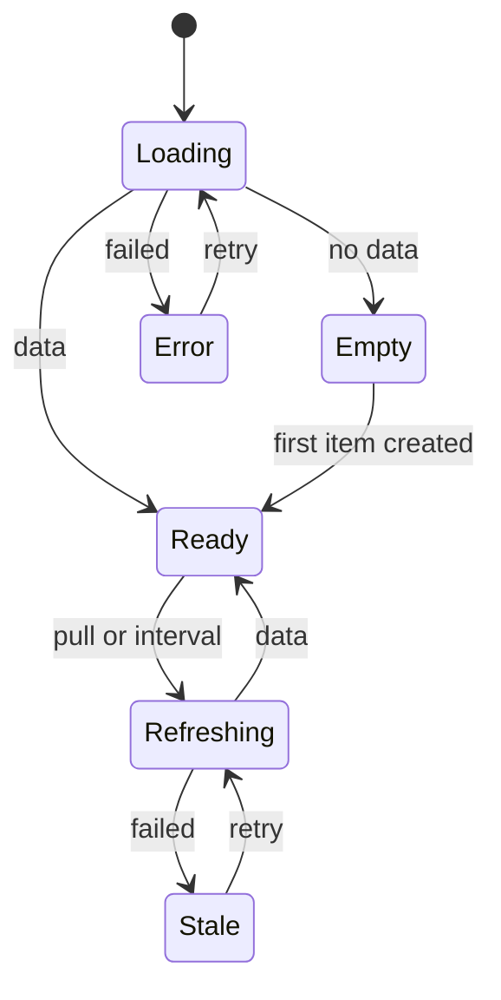

# States

A screen is not one picture. It is every picture it can show. Interfaces fail in the states nobody drew, and those are the states a generated interface most reliably skips. This file makes the set explicit, models it so impossible combinations cannot be built, and checks that each state exists.

Read it when building any screen in an app surface, and before claiming a screen is done.

## 1. Required states by screen family

Families are from `app-taxonomy.md`, Layer 4. A state that cannot occur keeps its line with `n/a: <reason>`. It is never silently dropped, because a dropped line and a forgotten one look the same.

| Family | Required states |
|---|---|
| **entry** | pristine, invalid, submitting, submit-error, resumed, blocked |
| **orientation** | loading, first-run, partial, error, dense |
| **collection** | loading, first-run, no-results, error, offline, permission-denied, single-item, dense, max-length |
| **object** | loading, not-found, error, permission-denied, max-length, missing-fields |
| **input** | pristine, invalid, submitting, submit-error, success, unsaved-exit |
| **outcome** | next-action |
| **system** | loading, saving, save-error, saved, permission-denied |

What each one means in practice:

- **loading** is a skeleton shaped like the content, shown only if the wait is long enough to notice.
- **first-run** teaches what belongs here and offers the first action. **no-results** names the active filter or query and offers to clear it. They are different screens (`app-taxonomy.md` §7).
- **partial** means some regions loaded and one failed. The failed region says so and retries on its own. The rest of the screen stays usable.
- **error** says what happened and what to do, and keeps whatever the user had typed.
- **offline** says what still works. **stale** content shows its age.
- **permission-denied** says who can grant access. A blank screen or a redirect home is a bug.
- **single-item** and **dense** are the two ends: one row should not look broken, and 100 or more should not scroll forever without a way to narrow.
- **max-length** is the 200-character name, the 14-digit amount, the unbroken URL.
- **missing-fields** is the record with no avatar, no description, no date.
- **unsaved-exit** is leaving with changes. Warn, autosave, or keep a draft, and say which.
- **resumed** is the user returning mid-flow days later. **blocked** is a prerequisite that cannot be met here (`flows.md` §5).
- **next-action** is the outcome screen's whole job: it never ends the journey.

Every interactive component additionally has rest, hover, focus, pressed, disabled and busy, checked once per component, not per screen.

## 2. Model the states as one value

Most missing and impossible states trace to modeling state as independent booleans. `isLoading`, `isError` and `data` allow eight combinations, of which three or four are meaningful and one is "loading and error at once".

Model each screen's data as a single value that can be exactly one thing:

```ts
type Projects =
  | { status: "loading" }
  | { status: "error"; message: string; retry: () => void }
  | { status: "empty"; reason: "first-run" | "no-results"; query?: string }
  | { status: "ready"; items: Project[]; refreshing: boolean; stale: boolean };
```

The view then switches on `status`, and the compiler reports a state with no rendering. This is the same rule as "make illegal states unrepresentable", applied to a screen. Use the stack's equivalent: a sealed class, an enum with associated values, a tagged union.

## 3. Draw it when it moves

When a screen or flow has more than four states, or any state that returns to an earlier one, draw the statechart before building. It finds the missing arrows: the error with no retry, the submit that can be pressed twice.



Label states with what the user sees ("Stale, showing yesterday's numbers"), not variable names. Then ask of every state: how does the user get out, and what happens if the action is repeated.

## 4. The manifest

For anything larger than one screen, record coverage in `states.json` next to the work. It is the checklist and the evidence in one file.

```json
{
  "root": ".",
  "screens": [
    {
      "name": "Projects",
      "type": "collection:table",
      "states": {
        "loading": "app/projects/loading.tsx",
        "first-run": "app/projects/empty.tsx#No projects yet",
        "no-results": "app/projects/empty.tsx#No projects match",
        "error": "app/projects/error.tsx",
        "offline": "n/a: server-rendered, the browser's own offline page applies",
        "permission-denied": "app/projects/page.tsx#You don't have access",
        "single-item": "screenshots/projects-1.png",
        "dense": "screenshots/projects-250.png",
        "max-length": "screenshots/projects-long.png"
      }
    }
  ]
}
```

Each value is one of:

- `path` to a file that implements or shows the state,
- `path#text`, where the text must appear in that file,
- `n/a: <reason>`, with a reason a reviewer could disagree with.

Check it:

```bash
python3 scripts/state_coverage.py states.json
python3 scripts/state_coverage.py --template collection:table,object:detail   # print a blank manifest
```

The script fails on a required state with no entry, an entry whose file does not exist, text that is not in the file, and an `n/a` with no reason. It cannot tell whether a state is well designed. It can tell that one was never made, which is the common failure.

A screenshot counts as evidence for a visual state, and is the only honest evidence for dense, single-item and max-length. Code proves the branch exists. A picture proves it was looked at.
