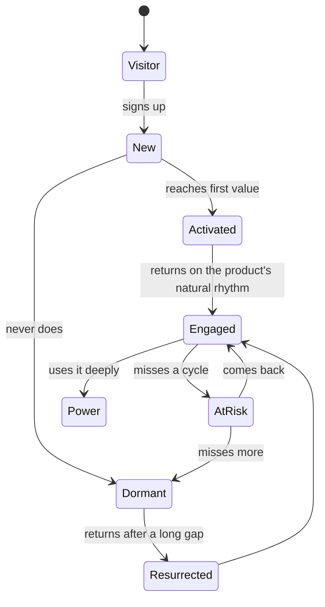

# The user lifecycle

A vocabulary for where a user is. "Engagement is down" is not a finding until it says which users, in which state, moving which way.

Each product sets its own thresholds, in `docs/product/context.md`. The states and the transitions are the same everywhere.



| State | Definition to fill in | The metric for getting here |
|---|---|---|
| **Visitor** | Seen, not signed up | Acquisition: visit to sign-up, by source |
| **New** | Signed up, not yet at first value | Sign-up completion |
| **Activated** | Did the activation sequence within N days | Activation rate, and time to first value |
| **Engaged** | Active in the current period, at the product's natural rhythm | Retention at the natural period |
| **Power** | Uses the core action far more than the median, or uses advanced features | Share of engaged users, depth of use |
| **At risk** | Was engaged, missed one period | The early warning. Size of this group, week over week |
| **Dormant** | Missed several periods | Churn |
| **Resurrected** | Returned after being dormant | Resurrection rate, and what brought them back |

## The natural rhythm

Before measuring retention, decide how often a user with the problem this product solves would need it. A ticketing app might be weekly or event-driven. A work tool is daily. A tax tool is yearly.

Measure retention at that rhythm. Daily retention for a weekly product reads as a crisis that is not happening. `retention.py --unit week` exists for this.

## Reading movement

Growth in active users is a sum:

```
active this period = new + retained + resurrected
change in active   = new + resurrected - churned
```

A flat total can hide a product that is acquiring fast and leaking as fast. Always report the parts.

## Which transition to work on

Work the transition that loses the most users who had already shown intent. In order of usual payoff:

1. **New to Activated.** Users who signed up wanted something. This is nearly always the largest loss, and the cheapest to move.
2. **Activated to Engaged.** They got value once. Why not twice?
3. **Engaged to Power.** The value is proven for them. What would they use if they knew it existed?
4. **Visitor to New.** More sign-ups into a leaking product is the most expensive way to grow.
5. **Dormant to Resurrected.** Worth it only when the reason they left has been fixed.

`playbooks/diagnose.md` finds which one is the constraint.
