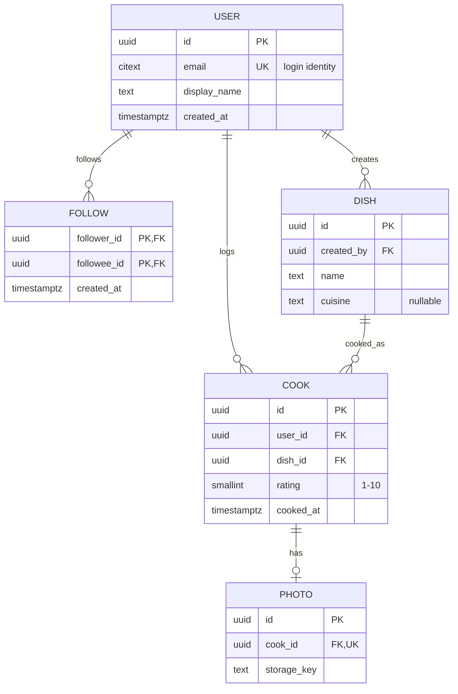
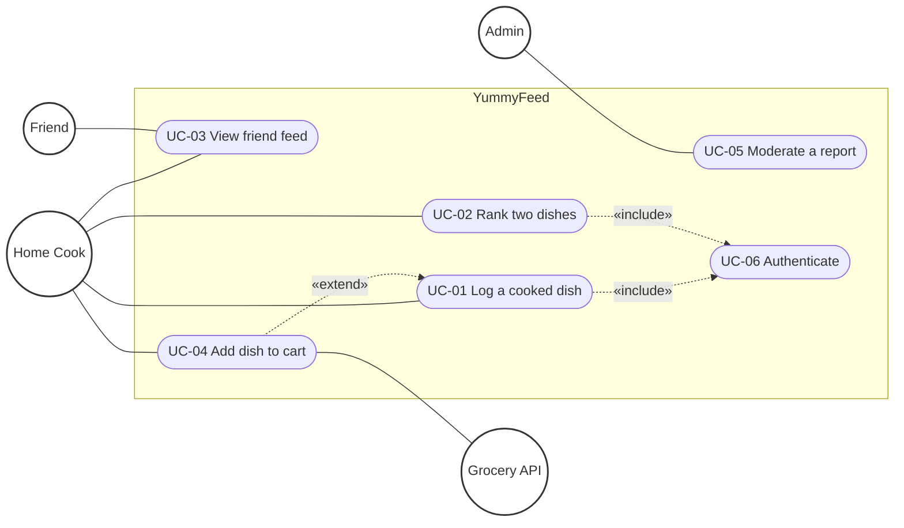
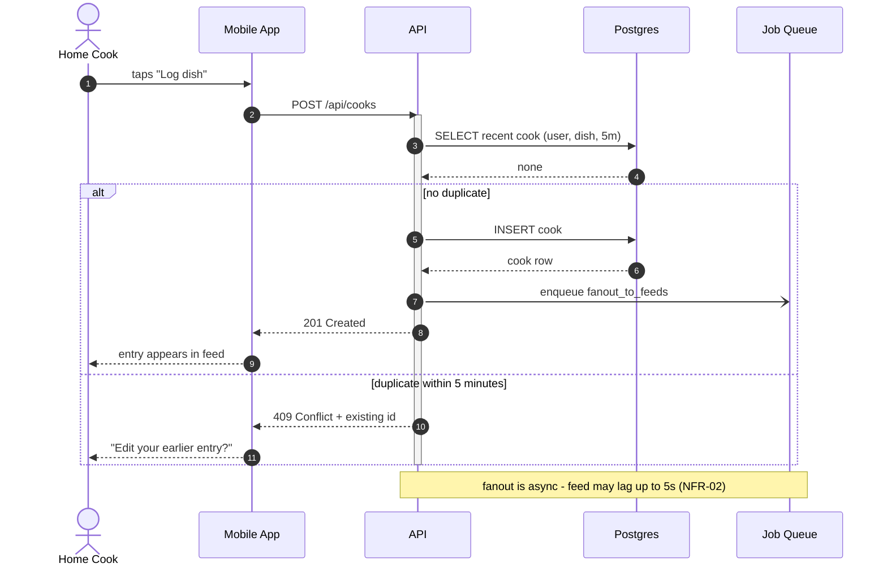
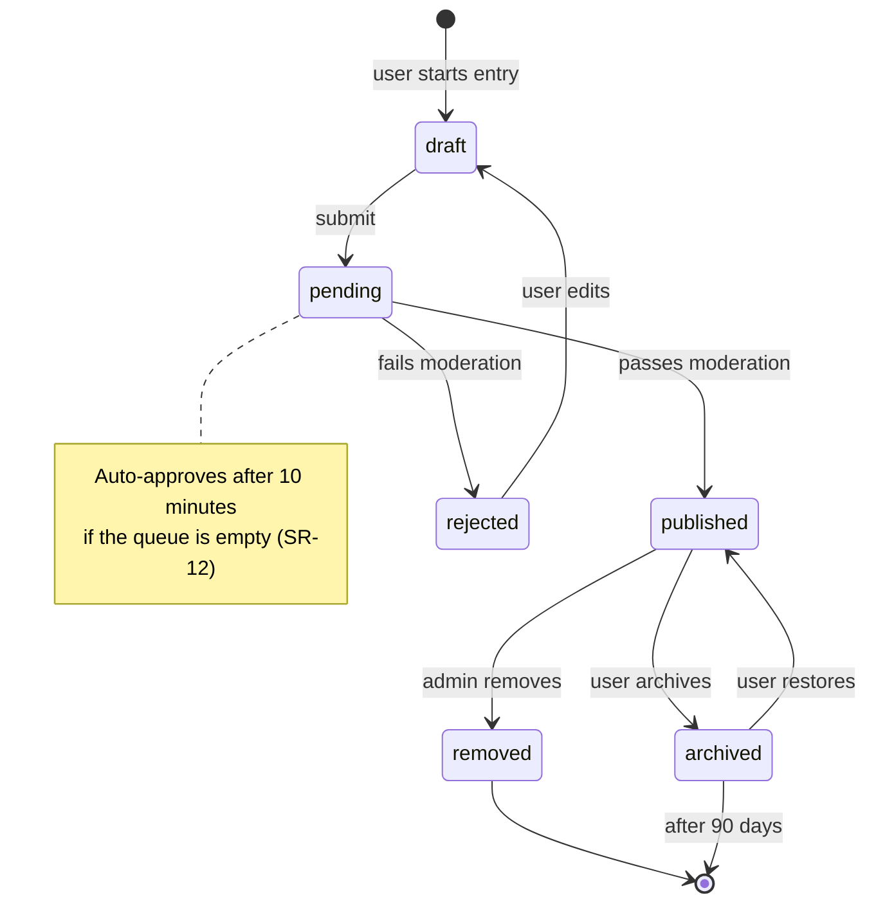
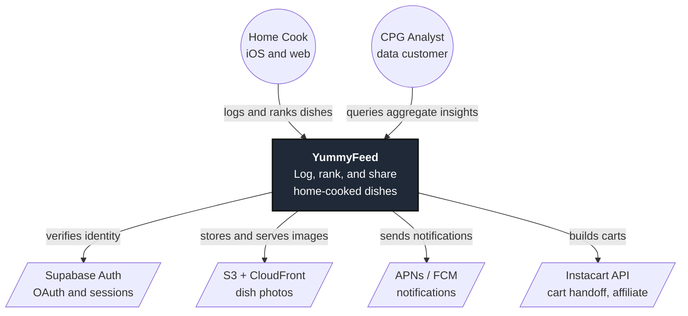
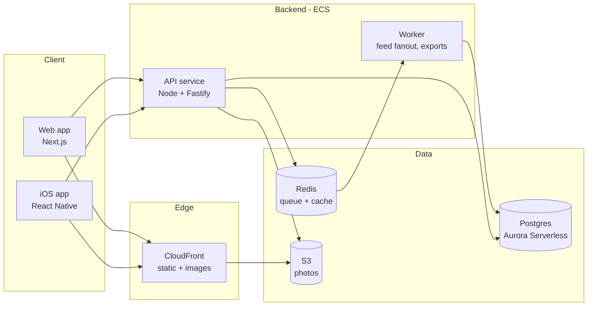
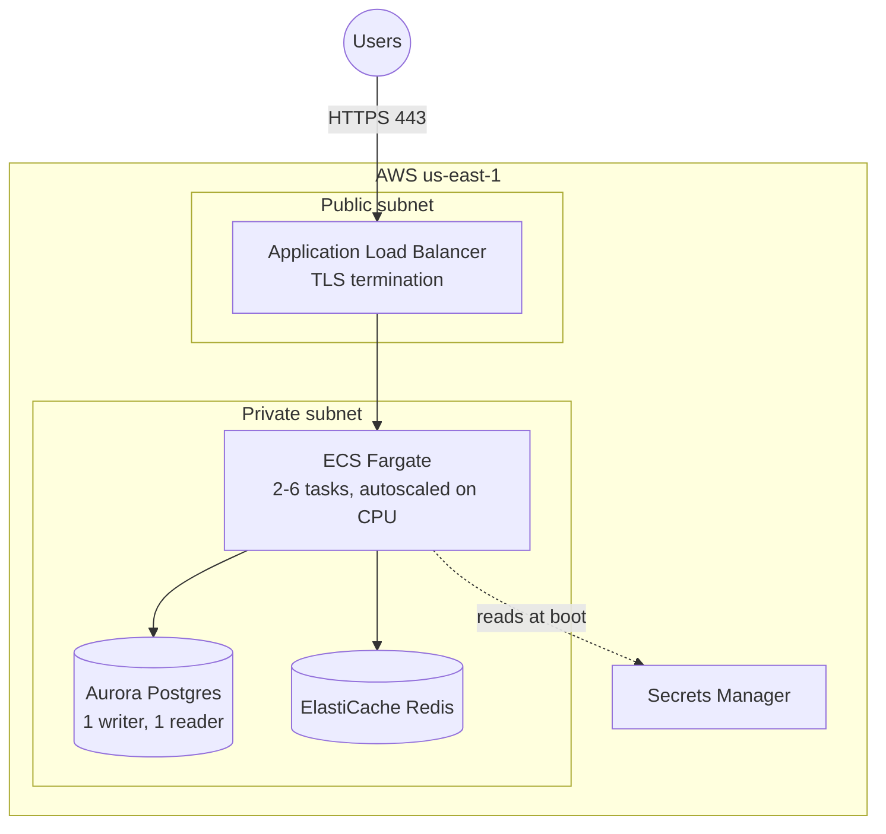

# Diagram recipes

All diagrams are Mermaid, written inline in the markdown. GitHub, GitLab, and Obsidian render Mermaid in markdown natively; VS Code needs the Markdown Preview Mermaid extension. Nobody needs an account or a license to edit one, which is the point.

Two rules that matter more than syntax:

**Keep each diagram under about fifteen nodes.** Past that, readers stop tracing lines and start skimming, and a diagram nobody traces is worse than no diagram - it looks like the system was understood. Split by concern instead: one context diagram, one container diagram, one sequence per flow.

**A diagram must add something the prose cannot.** A flowchart of three boxes in a row is a sentence with extra steps. Draw when the structure is genuinely hard to hold in a paragraph - relationships, concurrency, ordering across boundaries, state.

## Which diagram when

| Question the reader has | Diagram |
|---|---|
| What does the system store and how is it related? | ERD |
| Who can do what with this system? | Use case |
| What happens, in what order, across which components? | Sequence |
| What states can this thing be in, and how does it move? | State |
| What is inside the boundary and what is outside? | Context |
| What are the deployable pieces? | Container |
| Where does it actually run? | Deployment |

---

## ERD

For `03-data-model.md`. Show every entity and every relationship. Include the fields that carry meaning - keys, foreign keys, status columns, anything with a constraint. Leave out timestamps and audit columns unless they are load-bearing; they add rows to every box and tell the reader nothing.



**Cardinality.** The symbol nearest an entity describes that entity's side.

| Symbol | Meaning |
|---|---|
| `\|o` / `o\|` | zero or one |
| `\|\|` | exactly one |
| `}o` / `o{` | zero or more |
| `}\|` / `\|{` | one or more |

So `USER ||--o{ COOK` reads: exactly one user, zero or more cooks. Use `--` for identifying relationships (the child cannot exist without the parent) and `..` for non-identifying.

**Getting cardinality right is the whole exercise.** A one-to-many that is really a many-to-many costs a migration and a week of query rewrites. Before you draw each line, say both directions out loud: "one user has many cooks; one cook belongs to exactly one user." If either direction sounds wrong, it is.

Model many-to-many as its own entity with a composite key - `FOLLOW` above. Naming it forces you to notice it has attributes of its own, which it almost always does.

**Field lines are `type name key "comment"`.** Keys are `PK`, `FK`, `UK`, comma-separated for a composite. The relationship label after the colon is required; use `""` if there is genuinely nothing to say.

---

## Use case diagram

Mermaid has no native UML use case diagram, so build one from a flowchart. This recipe produces something a UML reader recognizes.

- Actors: circle nodes `((...))`, outside the boundary
- Use cases: stadium nodes `([...])`, inside a subgraph that acts as the system boundary
- Association: a plain line `---`, no arrowhead
- `«include»` and `«extend»`: dotted arrows `-.->` with the label
- Actor generalization: an open arrow `-->` between actors



Put secondary actors - external systems the use case calls, rather than people who initiate it - on the right side. It keeps initiation flowing left to right and makes the diagram readable at a glance.

**Include versus extend** is worth getting right, because reviewers notice. `«include»` means the base use case always performs the included one - logging a dish always requires authenticating. `«extend»` means the extending use case sometimes adds to the base under a condition - adding to cart may follow logging a dish, but usually does not. When unsure, prefer `«include»`; over-using `«extend»` is the more common mistake.

Every actor in `04-flows.md`'s actor table appears here. An actor with no line to any use case means either a missing use case or an actor who does not belong in the system.

---

## Sequence diagram

For `04-flows.md`. One per flow that crosses a boundary. Show the failure path - a sequence diagram with only the happy path documents the demo.



**Arrow types carry meaning, so use them deliberately.**

| Arrow | Meaning |
|---|---|
| `->>` | synchronous call |
| `-->>` | return or response |
| `-)` | asynchronous fire-and-forget |
| `--x` | call that failed or was dropped |

`activate` / `deactivate` show how long something holds a resource - worth using on anything holding a connection, a lock, or a transaction. Blocks: `alt`/`else`, `opt`, `loop`, `par`/`and`, `critical`/`option`, each closed with `end`.

Cross-reference requirement IDs in `Note` lines, as above. It is how a reader gets from a picture back to the requirement that forced it.

---

## State diagram

For `03-data-model.md`, for any entity with a `status` or `state` column. Undocumented status columns turn into free-text fields within two months, because the second person to touch the code invents a value.



Label every transition with what causes it. An unlabeled arrow between two states is the interesting information left out.

Check for two things before you move on: **states that cannot be left** (unless they are genuinely terminal - if `rejected` has no way out, users are stuck), and **states nothing reaches**, which are dead code waiting to be written.

---

## Context diagram

For `02-srd.md`. The system as one box, with everyone and everything that touches it. Mermaid has an experimental `C4Context` type, but its rendering is inconsistent across viewers - a flowchart is portable and does the same job.



Label every edge with what flows across it, not just that a connection exists. "Uses" tells the reader nothing they could not infer from the line.

---

## Container diagram

The deployable pieces and how they talk. This one goes in `02-srd.md` and gets copied into `00-orientation.md`, because it is the picture a new teammate needs on day one.



Use `[( )]` for anything that stores state. Making storage visually distinct is what lets someone spot at a glance where the durability and backup concerns live.

---

## Deployment diagram

Where it runs, per environment. Include the boring parts - VPC boundaries, which things are public, where secrets come from. These are what someone needs when the thing is broken at 2am and they have never seen the infrastructure.



---

## Parser gotchas

Most Mermaid failures are one of these. Check against the list before assuming a diagram is broken.

**Quote any label containing punctuation.** Parentheses, brackets, braces, colons, and quotes all break the parser unquoted.

```
A[Auth (OAuth)]        breaks
A["Auth (OAuth)"]      works
A["He said #quot;hi#quot;"]   escaped quote inside a quoted label
```

**`end` is a reserved word in flowcharts.** A node called `end`, or a label starting with a bare lowercase `end`, closes the enclosing subgraph early. Quote it or capitalize it.

**Node IDs take no spaces or hyphens.** Use `snake_case` for the ID and put the display text in the label: `feed_service["Feed service"]`.

**Line breaks are `<br/>`.** A literal `\n` renders as the characters backslash-n.

**In `erDiagram`, the relationship label is mandatory.** `USER ||--o{ COOK : ""` if there is nothing to say.

**Entity and attribute names in `erDiagram` cannot contain spaces** unless quoted, and quoted entity names need Mermaid 10.1 or newer. Prefer `snake_case` table names, which is what the database will use anyway.

**Every block opener needs its `end`** - `subgraph`, `alt`, `opt`, `loop`, `par`, `critical`, `state ... {`. An unclosed block usually fails with an error pointing at a line much further down than the real problem, so check openers first.

**Comments are `%%` at the start of a line.** Inline after content, they are unreliable.

**Prefer `flowchart` over `graph`.** Both parse; `flowchart` is current and supports more shapes.

**Keep styling minimal.** `classDef` and `style` render differently across viewers and dark themes. A diagram that depends on color to be readable is not readable in half the places it will be viewed.

`scripts/check_docs.py` catches the common cases - unclosed blocks, unquoted punctuation in labels, unknown diagram types, missing ERD relationship labels. Run it before delivering, but read the list above first, because it catches more than the script does.
